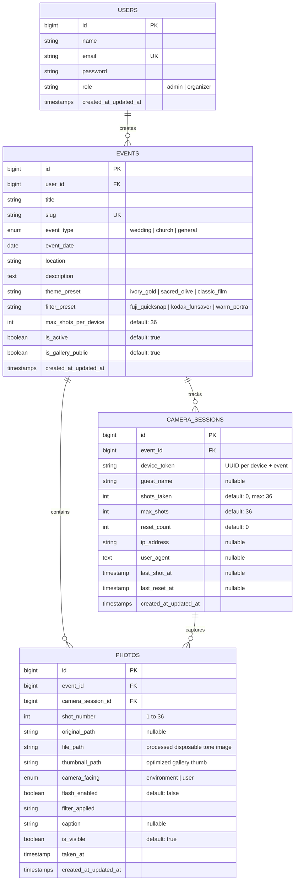

# Project Planning: Retro Wedding Camera (Laravel)

Dokumen ini memuat perencanaan teknis, desain arsitektur, skema database MySQL, spesifikasi fitur, dan pembagian *milestone/issues* untuk pengembangan aplikasi **Retro Wedding Camera** (`retroweddingcamera-laravel`).

---

## 1. Gambaran Umum Proyek (Project Overview)

- **Nama Proyek**: Retro Wedding Camera
- **Repository**: `https://github.com/euqith/retroweddingcamera-laravel.git`
- **Framework & Database**: Laravel (PHP 8.2+) & MySQL
- **Target Penggunaan**: Acara Pernikahan (*Wedding Reception / Holy Matrimony*) dan Acara Gereja (*Church Events / Youth / Retreat / Christmas & Easter Service*).
- **Konsep Utama**: Mengubah smartphone tamu undangan menjadi kamera *disposable* (sekali pakai) berbasis web dengan batasan **36 foto per perangkat**, memproses hasil foto dengan *color grading* khas kamera analog sekali pakai (sesuai referensi di folder `attachment/`), serta mengumpulkan seluruh foto secara otomatis ke dalam galeri event yang dapat diakses melalui QR Code.
- **Referensi Utama**: [Instagram Reel — Digital Disposable Camera](https://www.instagram.com/reel/DdvkrcRpy9G/?psln=MTF4NTFnenEzMW96ag%3D%3D)

---

## 2. Arsitektur & Tech Stack

| Komponen | Teknologi | Keterangan |
| :--- | :--- | :--- |
| **Backend Framework** | Laravel 11/12 (PHP 8.2+) | Routing, Eloquent ORM, Auth, Event & Session Management, File Storage |
| **Database** | MySQL 8.0+ | Penyimpanan relasional untuk `users`, `events`, `camera_sessions`, dan `photos` |
| **Frontend UI** | Blade + Tailwind CSS + Alpine.js | Antarmuka kamera responsif (*mobile-first*), animasi kokang film, dan galeri |
| **Camera & Media API** | WebRTC `navigator.mediaDevices.getUserMedia` | Akses kamera belakang & depan (*selfie*) langsung dari browser HP |
| **Image Tone Pipeline** | HTML5 `<canvas>` 2D/WebGL + Intervention Image | Penerapan efek kamera *disposable* (LUT warna, *grain*, *vignette*, *flash bloom*, *date stamp*) |
| **QR Code Generator** | `simplesoftwareio/simple-qrcode` | Pembuatan QR Code khusus URL Kamera dan URL Galeri per event |

---

## 3. Desain Skema Database (MySQL)

---

## 4. Spesifikasi Fitur & Modul

### 4.1. Desain UI/UX Khusus Tema Wedding & Acara Gereja
- **Palet Warna & Tipografi**:
  - Warna dasar hangat nan elegan: *Warm Ivory* (`#FAF6F0`), *Champagne Gold* (`#C5A059`), *Sacred Olive/Sage* (`#6B7B6E`), dan *Deep Espresso* (`#231F1E`).
  - Tipografi *Serif* klasik (*Cormorant Garamond* / *Playfair Display*) untuk judul acara pernikahan/gereja, dipadukan dengan *Sans-Serif* modern (*Plus Jakarta Sans*) dan font *Monospace* mekanikal untuk penghitung sisa roll film (`36` s/d `00`).
- **Tampilan Kamera Disposable (Skeuomorphic Web View)**:
  - Bodi kamera memiliki *sleeve/cover* bertema acara (nama pasangan pengantin atau nama acara gereja).
  - Jendela bidik (*viewfinder*), indikator lampu *Flash*, tombol *Switch Camera* (Belakang / Selfie), indikator angka sisa film mekanis, dan tombol *Shutter* dengan efek suara jepretan & putaran roda film.

### 4.2. Modul Kamera Disposable & Limitasi 36 Foto per Device
- Mendukung pengambilan foto menggunakan kamera belakang (`facingMode: "environment"`) maupun **Selfie** (`facingMode: "user"` dengan transformasi *horizontal flip* agar natural).
- Setiap perangkat memiliki identitas unik (`device_token` yang disimpan di `localStorage` dan HTTP Cookie berdurasi panjang serta divalidasi ke tabel `camera_sessions`).
- Batas maksimal adalah **36 foto per device** pada setiap event:
  - Setiap kali foto berhasil diambil, `shots_taken` bertambah `1` dan layar menampilkan sisa film (`36 - shots_taken`).
  - Saat mencapai `36/36`, tombol *shutter* terkunci otomatis dan menampilkan layar **"Roll Film Habis (36/36)"** beserta tautan langsung menuju **Gallery Event**.

### 4.3. Pipeline Tone Warna Kamera Disposable (Sesuai Referensi `attachment/`)
Berdasarkan analisis sampel foto asli di folder `attachment/` (`IMG_2820.JPG`, `IMG_2821.JPG`, `IMG_2823.JPG`, `IMG_2825.JPG`, `IMG_2831.JPG`, `IMG_2832.JPG`), karakter visual yang harus direplikasi meliputi 2 kondisi pencahayaan utama (Daylight & Indoor Direct Flash):
1. **Color Curve & Tone Mapping**:
   - *Highlights*: Warm creamy/ivory tint pada warna putih (seperti terlihat pada bodi mobil putih di `IMG_2821.JPG`) serta saturasi warna hangat (merah/oranye) yang hidup.
   - *Shadows*: Sedikit diangkat (*faded matte black*) dengan *greenish-cyan / warm-brown shadow cast* pada area kurang cahaya (`IMG_2823.JPG` & `IMG_2831.JPG`).
   - *Direct Flash Falloff (Mode Flash)*: Eksposur terang terpusat pada subjek depan dengan *falloff* cepat (gelap berbintik/grainy) pada latar belakang ruangan.
2. **Optical Imperfections (Karakter Lensa Plastik 32mm f/10)**:
   - *Fixed-focus softness* (sedikit *soft* pada objek terlalu dekat dan bagian tepi frame).
   - *Subtle Chromatic Aberration* (pergeseran tipis channel R/B di sudut kontras tinggi) dan *natural barrel vignette*.
3. **35mm Color Negative Film Grain**:
   - Lapisan *organic color film grain* ISO 400/800 yang lebih terasa di area *midtones* dan *underexposed shadows*.

### 4.4. Manajemen Event & Integrasi Galeri
- **CRUD Event (Admin Panel)**:
  - Membuat event baru (judul, *slug* unik, kategori Wedding/Gereja, tanggal, lokasi, tema *casing* kamera, dan preset warna film).
- **Galeri Event Terintegrasi (`/e/{slug}/gallery`)**:
  - Setiap foto yang diambil langsung masuk ke galeri event terkait.
  - Fitur filter berdasarkan tamu/perangkat, tampilan *grid* bergaya cetakan foto analog / *contact sheet*, *lightbox* pratinjau penuh, tombol *Download* foto (satuan maupun ZIP untuk admin), serta moderasi sembunyikan/hapus foto oleh admin.

### 4.5. Fitur Generate QR Code (Event Camera & Gallery)
Setiap event memiliki halaman & fitur **QR Code Generator** otomatis:
1. **QR Code Kamera (`/e/{slug}/camera`)**: Mengarahkan tamu langsung ke antarmuka kamera disposable event tersebut.
2. **QR Code Galeri (`/e/{slug}/gallery`)**: Mengarahkan tamu atau jemaat ke halaman album galeri foto event.
3. **Cetak / Unduh QR Card**: Dapat diunduh dalam format PNG/SVG maupun *template* kartu meja (*table tent card*) siap cetak bertema Wedding / Gereja.

### 4.6. Fitur Reset Roll Kamera (Admin & Keperluan Testing Development)
- **Reset via Dashboard Admin**: Admin dapat melihat daftar perangkat (`camera_sessions`) yang terhubung pada suatu event beserta status kuotanya (misal `36/36`), lalu menekan tombol **"Reset Roll"** untuk mengembalikan `shots_taken` perangkat tersebut menjadi `0` (dengan opsi mempertahankan atau menghapus foto pengujian sebelumnya).
- **Quick Reset saat Development**: Tersedia tombol/aksi cepat *Reset Device Roll* pada antarmuka kamera (khusus saat login sebagai Admin atau saat `APP_ENV=local`) agar proses *testing* pengambilan 36 foto dapat diulang dengan mudah tanpa perlu menghapus *storage* browser secara manual.

---

## 5. Struktur URL & Endpoint Rencana

| Method | URI | Nama Route | Deskripsi |
| :--- | :--- | :--- | :--- |
| `GET` | `/` | `home` | Landing page informasi platform Retro Wedding Camera |
| `GET` | `/e/{event:slug}` | `event.landing` | Halaman sambutan event (pilihan buka Kamera atau Galeri) |
| `GET` | `/e/{event:slug}/camera` | `event.camera` | Antarmuka utama Kamera Disposable Digital (maks 36 foto) |
| `POST` | `/e/{event:slug}/camera/capture` | `event.camera.capture` | Endpoint upload & simpan foto hasil jepretan + update kuota roll |
| `GET` | `/e/{event:slug}/gallery` | `event.gallery` | Halaman Galeri seluruh foto yang diambil pada event tersebut |
| `POST` | `/e/{event:slug}/session/reset` | `event.session.reset` | Reset kuota roll 36 foto pada device saat ini (Admin / Dev Mode) |
| `GET` | `/admin/events` | `admin.events.index` | Dashboard manajemen daftar event, kuota device, dan foto |
| `POST` | `/admin/events` | `admin.events.store` | Buat event pernikahan / acara gereja baru |
| `GET` | `/admin/events/{event}/qrcodes` | `admin.events.qrcodes` | Generate & unduh QR Code Kamera dan QR Code Galeri |
| `POST` | `/admin/sessions/{session}/reset` | `admin.sessions.reset` | Reset roll kamera untuk device tertentu oleh Admin |

---

## 6. Rencana Tahapan Pengerjaan (Milestones & GitHub Issues)

Berikut adalah daftar **GitHub Issues** yang dibuat pada repository proyek untuk memandu pengembangan secara terstruktur:

1. **Issue #1 — [Setup] Inisialisasi Proyek Laravel, Konfigurasi Database MySQL & Struktur Dasar**
2. **Issue #2 — [Database] Desain & Migrasi Skema Database (Events, Camera Sessions, Photos)**
3. **Issue #3 — [Feature] Modul Manajemen Event (CRUD Event Wedding & Acara Gereja)**
4. **Issue #4 — [UI/UX] Desain Antarmuka Tema Wedding & Gereja + Casing Kamera Disposable**
5. **Issue #5 — [Feature] Core Kamera Disposable WebRTC (Rear Camera, Selfie Mode & Limit 36 Foto/Device)**
6. **Issue #6 — [Feature] Pipeline Pemrosesan Tone Foto Kamera Disposable (Retro Film Filter)**
7. **Issue #7 — [Feature] Galeri Foto Event Terintegrasi & Live View**
8. **Issue #8 — [Feature] Generator QR Code untuk Kamera Event & Galeri Event**
9. **Issue #9 — [Feature] Fitur Reset Roll Kamera oleh Admin (Keperluan Testing & Development)**
10. **Issue #10 — [QA] Pengujian End-to-End Lintas Perangkat Mobile & Optimasi Performa Upload Foto**
